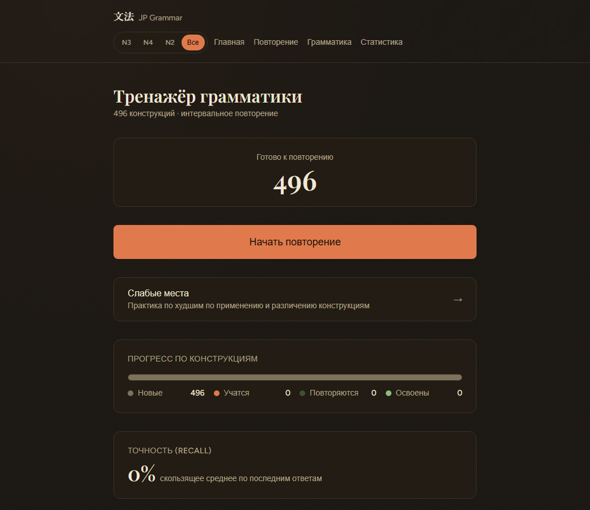
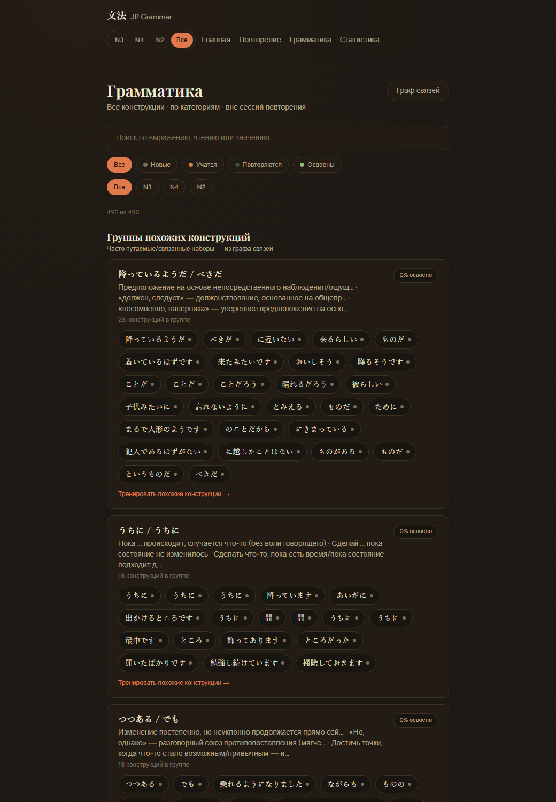
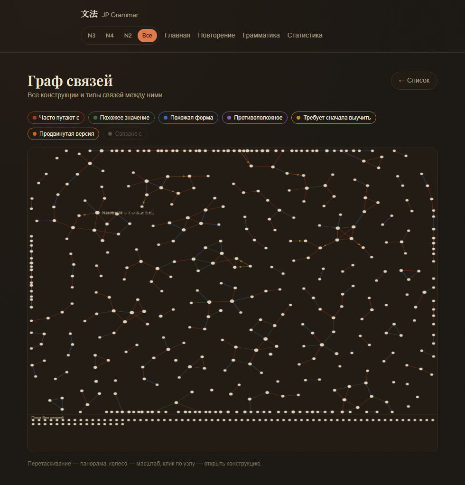

<div align="center">

# 文法 JP Grammar

**A spaced-retrieval trainer for JLPT N4 · N3 · N2 grammar.**<br>
Active recall instead of re-reading — 4-choice questions, an SRS scheduler, and a graph of which grammar points you actually confuse.




</div>

## Why

Textbooks (I use *Shin Kanzen Master*) teach a grammar point, drill it for a lesson, and move on.
Ten lessons later `わけではない` and `とは限らない` blur together, and re-reading the same example
sentence only trains *recognition* — not the ability to **pick the right construction in a new
context**. This app is the missing layer: it keeps every grammar point you have learned in active
rotation and trains you specifically on the pairs you mix up.

It is a **personal, single-user tool** — no accounts, no auth, no payments.

## Features

| | |
|---|---|
| **496 grammar points** | N3 (205, from my own curated Anki deck) · N4 (142) · N2 (149, all 26 Shin Kanzen Master lessons). Russian explanations, formation rules per part of speech, one furigana-annotated example each. |
| **Contrastive questions** | 4-choice fill-in-the-blank. Distractors are drawn from the grammar points you are *likely to confuse the answer with*, not random ones. |
| **SRS** | Fixed interval ladder `0 → 1 → 3 → 7 → 14 → 30 → 60 → 120 days`. A mistake drops two steps (not to zero). Per-item recall, application and discrimination scores. |
| **Review modes** | Due · **Confusion practice** (only items linked by a "commonly confused" edge) · **Weak points** (lowest application/discrimination scores). Scoped to N3 / N4 / N2 or all. |
| **Relation graph** | 377 hand-curated relations (*commonly confused*, *similar form/meaning*, *opposite*, *prerequisite*, *advanced version*) with a one-line explanation of the actual distinction. Force-directed canvas view. |
| **Dashboard-style browser** | Grammar grouped into 21 semantic categories plus "families" of mutually confusable constructions, each with a Russian summary and mastery %. |
| **Adaptive furigana** | Always · by JLPT level · **adaptive** (hides readings for words you have demonstrably learned) · never. 2 014 words/kanji tracked. |
| **Optional AI generation** | Fresh example sentences via Anthropic **or** OpenAI (switchable). Works fully without a key — ~490 seed questions ship in the repo. |
| **PWA** | Installable, offline app shell. |

<table>
<tr>
<td width="50%"></td>
<td width="50%"></td>
</tr>
<tr>
<td align="center"><sub>Confusable "families" and category sections</sub></td>
<td align="center"><sub>Curated relation graph (hover shows how two points differ)</sub></td>
</tr>
</table>

## Quick start

**Requirements:** Docker, [uv](https://docs.astral.sh/uv/), Node 20+.

### Windows — one click

Double-click **`Start App.vbs`**. It starts Postgres, runs migrations, seeds everything, launches
the backend and frontend with no console windows, and opens <http://localhost:3000>.
`Stop App.vbs` shuts it all down (your progress stays in a Docker volume).

### Any OS

```bash
./setup.sh                 # Postgres (docker) + migrations + all seed data   (setup.ps1 on Windows)

cd backend  && cp .env.example .env && uv run python -m uvicorn app.main:app --reload
cd frontend && cp .env.example .env.local && npm install && npm run dev
```

Open <http://localhost:3000>. API docs at <http://localhost:8000/docs>, machine-readable API
summary at `/llms.txt`.

### Enabling AI generation (optional)

Put a key in `backend/.env` and pick the provider:

```env
LLM_PROVIDER=anthropic        # or: openai
ANTHROPIC_API_KEY=...
OPENAI_API_KEY=...
```

With a key, the backend tops up each grammar point with freshly generated sentences when its
unused-question pool runs low. Without one everything else keeps working.

## How the memory model works

Every grammar point has a `grammar_progress` row:

```
interval_step ─ position on the ladder 0·1·3·7·14·30·60·120 days
repetitions   ─ consecutive correct answers          lapses ─ total mistakes
recall_score  ─ EMA of correctness (α=0.2, ≈ last 5 answers)
application_score    ─ accuracy on freshly generated sentences (not the memorised seed one)
discrimination_score ─ accuracy on questions whose distractors were real confusion pairs
```

* correct → one step up, longer interval · wrong → **two steps down**, repetitions reset
* status (*new / learning / review / mastered*) is **derived** from the step, never stored
* a card is *due* when `next_review <= now`

Vocabulary exposure is tracked per word; a word counts as known after enough consecutive correct
answers on sentences containing it, and adaptive furigana stops showing its reading.

## Architecture

```
frontend/   Next.js 15 (App Router) · TypeScript strict · Tailwind · PWA
backend/    FastAPI · SQLAlchemy 2 · Alembic · psycopg 3 · typed (mypy --strict) + beartype
            ├─ routers/    grammar · review · stats
            ├─ services/   srs · review modes · distractors · furigana · vocabulary · LLM generation
            └─ scripts/    idempotent seed + relation importers
data/seed/  the content: N3 Anki export, authored N4/N2, curated relations, vocabulary snapshot
```

Design notes, ADRs and the full schema live in [`ARCHITECTURE.md`](./ARCHITECTURE.md); the
original idea is [`IDEA.md`](./IDEA.md) and the product spec [`SPEC.md`](./SPEC.md).

## Content & data

* **N3** — exported from my personal Anki deck (205 notes, Russian).
* **N4 / N2** — grammar inventory taken from published JLPT / Shin Kanzen Master grammar lists;
  explanations, formation rules and example sentences were then authored and audited
  (the audit fixed ~30 kanji/furigana errors).
* **Relations** — classified by hand, each with a note on the real difference between the two
  constructions. No heuristic or auto-generated edges.
* Seeds are idempotent: re-running the importers never duplicates rows or touches your progress.

*Shin Kanzen Master* is a trademark of its publisher. This project contains original
explanations only, not reproductions of the textbook.

## Development

```bash
cd backend  && uv run pytest && uv run mypy app      # 150+ tests (need a Postgres on :5544 for DB tests)
cd frontend && npx tsc --noEmit && npm run build
```

## Roadmap

- [x] Scope a confusion-practice session to one "family" (the "Тренировать похожие конструкции" link on a /grammar group card)
- [x] LLM re-classification of relations once an API key is configured — code path behind `LLM_RELATION_RECLASSIFY` (`python -m app.scripts.generate_relations --reclassify`); untested against a real provider
- [ ] N5 / N1 — importer/validator/seed slots are ready (`data/seed/README.md`); the content itself still has to be authored from a real source
- [x] Sentence-production practice (`/produce`, offline) · [ ] speaking practice

---

<sub>Personal project — built for my own Japanese study.</sub>
